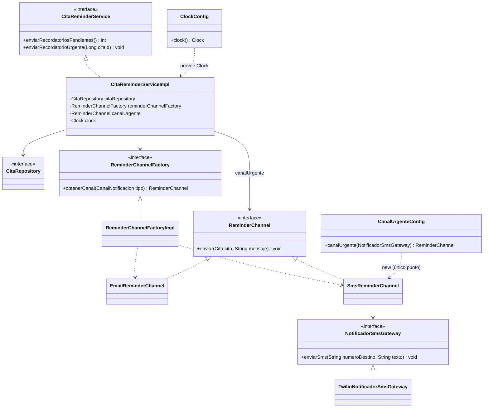
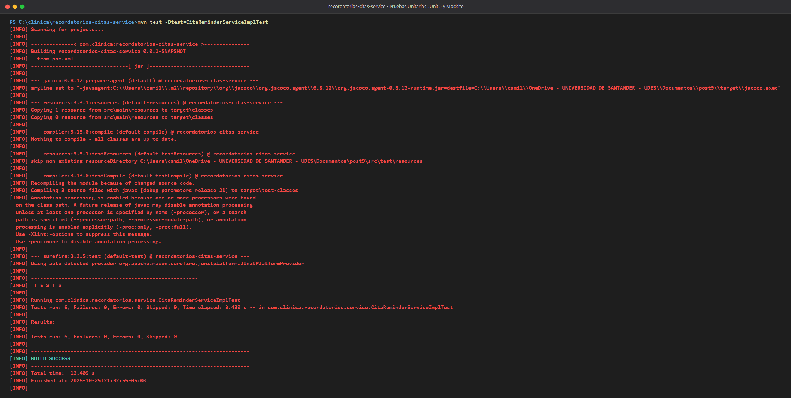
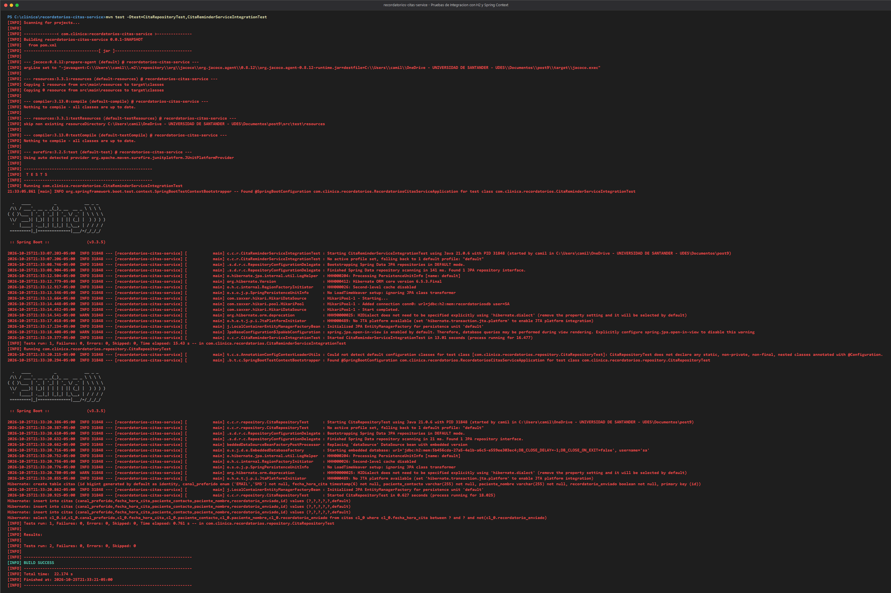
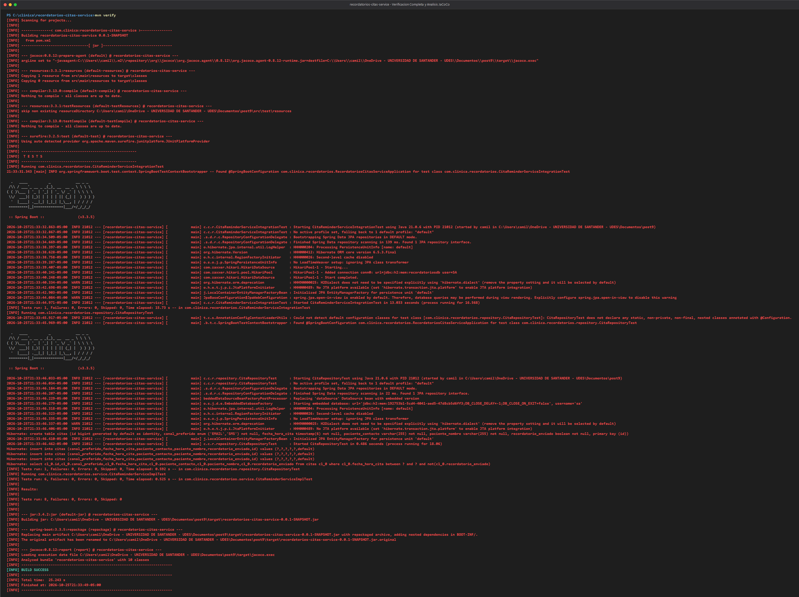
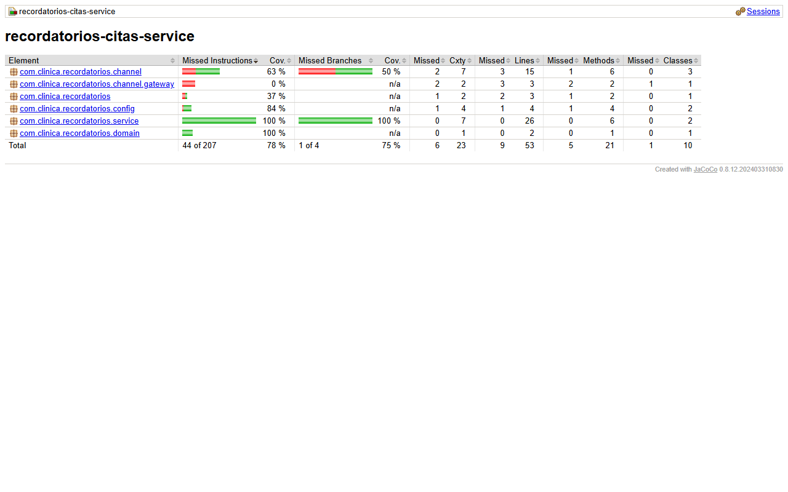
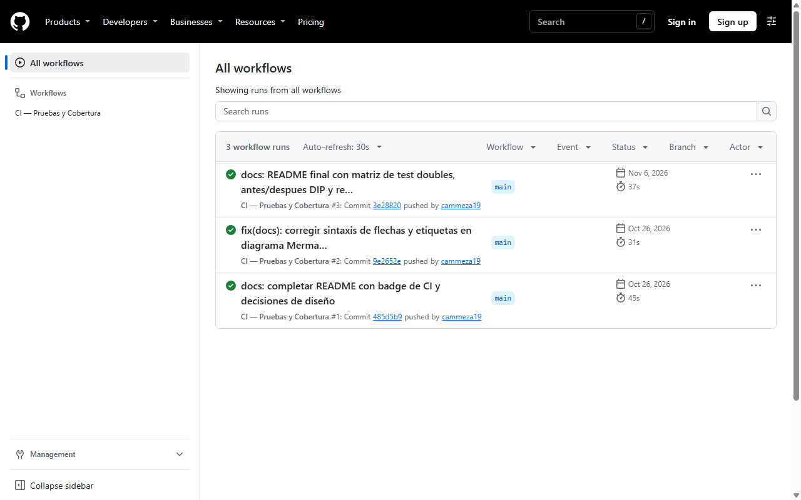
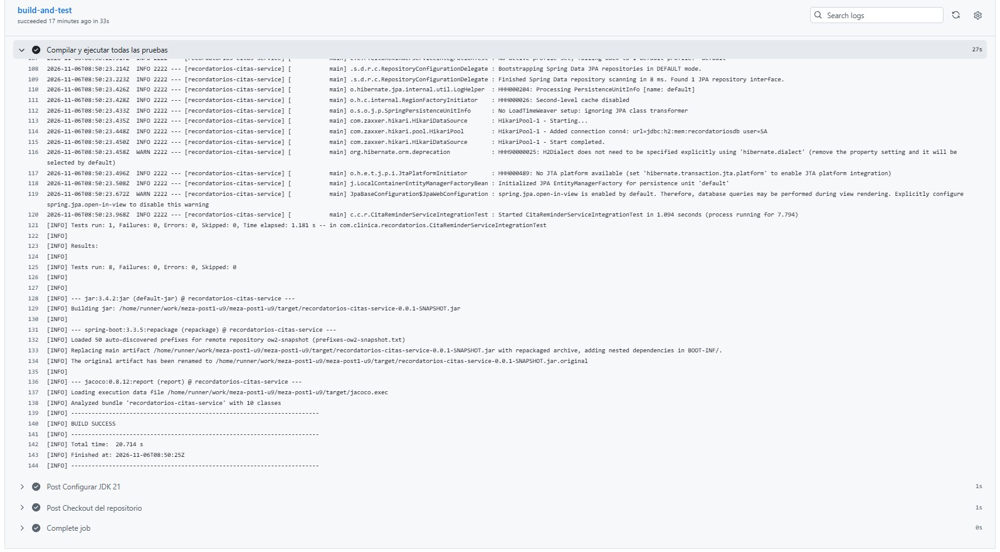
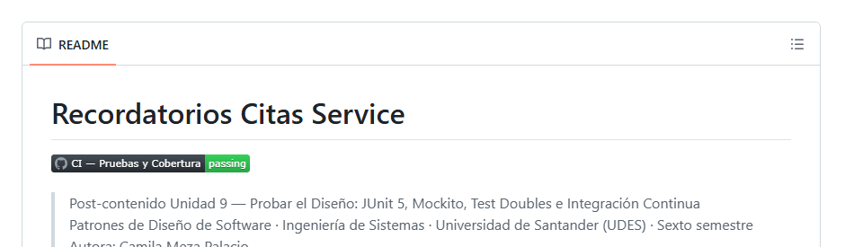
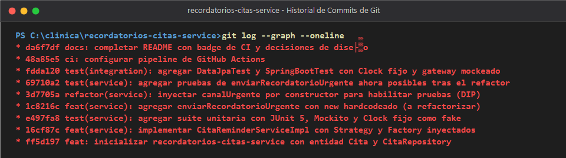

# Recordatorios Citas Service


> Post-contenido Unidad 9 — Probar el Diseño: JUnit 5, Mockito, Test Doubles e Integración Continua  
> Patrones de Diseño de Software · Ingeniería de Sistemas · Universidad de Santander (UDES) · Sexto semestre  
> Autora: Camila Meza Palacio

## Tabla de contenido

1. [Descripción](#descripción)
2. [Arquitectura](#arquitectura)
3. [Parte 1 — Aislamiento y pruebas unitarias](#parte-1--aislamiento-y-pruebas-unitarias)
4. [Parte 2 — Refactor DIP, integración y CI/CD](#parte-2--refactor-dip-integración-y-cicd)
5. [Decisiones de diseño](#decisiones-de-diseño)
6. [Suite de pruebas](#suite-de-pruebas)
7. [Ejecutar las pruebas](#ejecutar-las-pruebas)
8. [Evidencias](#evidencias)
9. [Herramientas utilizadas](#herramientas-utilizadas)
10. [Conclusiones](#conclusiones)

## Descripción

Microservicio en Spring Boot 3.3.5 sobre Java 21 que detecta las citas médicas programadas dentro de las próximas 24 horas cuyo recordatorio aún no se ha enviado, y notifica a cada paciente por su canal preferido (`EMAIL` o `SMS`). Además expone un envío **urgente** por SMS para citas a menos de dos horas.

El servicio central, `CitaReminderServiceImpl`, nace diseñado con dos patrones del curso, ambos inyectados por constructor según el Principio de Inversión de Dependencias (DIP):

| Patrón | Rol en el proyecto | Abstracción |
|---|---|---|
| **Strategy** (Unidad 4) | Cada canal de envío es una implementación intercambiable con la misma firma | `ReminderChannel` → `EmailReminderChannel`, `SmsReminderChannel` |
| **Factory Method** (Unidad 2) | Selecciona en tiempo de ejecución la estrategia según `cita.getCanalPreferido()` | `ReminderChannelFactory` → `ReminderChannelFactoryImpl` |
| **DIP / Composition Root** | Toda construcción de objetos concretos vive en `config/`, nunca en la lógica de negocio | `ClockConfig`, `CanalUrgenteConfig` |

## Arquitectura



```
src/main/java/com/clinica/recordatorios/
├── RecordatoriosCitasServiceApplication.java
├── domain/            Cita (@Entity, tabla "citas"), CanalNotificacion (EMAIL, SMS)
├── repository/        CitaRepository (JpaRepository<Cita, Long>)
├── channel/           ReminderChannel, EmailReminderChannel, SmsReminderChannel,
│   │                  ReminderChannelFactory, ReminderChannelFactoryImpl
│   └── gateway/       NotificadorSmsGateway, TwilioNotificadorSmsGateway
├── service/           CitaReminderService, CitaReminderServiceImpl, CitaNoEncontradaException
└── config/            ClockConfig, CanalUrgenteConfig  ← composition root

src/test/java/com/clinica/recordatorios/
├── service/           CitaReminderServiceImplTest (unitarias, Mockito)
├── repository/        CitaRepositoryTest (@DataJpaTest + H2)
└──                    CitaReminderServiceIntegrationTest (@SpringBootTest + H2 + @MockBean)
```

Los paquetes de prueba replican la estructura de producción: cada clase de prueba vive en el mismo paquete que la clase que verifica.

## Parte 1 — Aislamiento y pruebas unitarias

`CitaReminderServiceImplTest` aísla por completo `CitaReminderServiceImpl` de sus colaboradores. El servicio se construye manualmente en `@BeforeEach` con:

- `@Mock CitaRepository` — controla la consulta y verifica cada `save(...)`.
- `@Mock ReminderChannelFactory` + `@Mock ReminderChannel` — verifican que se seleccionó y usó la estrategia correcta.
- `Clock.fixed(Instant.parse("2026-08-10T09:00:00Z"), ZoneId.of("UTC"))` — Fake del JDK, no un mock.

Gracias a Strategy y Factory, la prueba nunca toca SMTP, HTTP ni base de datos: verifica únicamente la **orquestación** del servicio. Con el reloj congelado, un `ArgumentCaptor` comprueba los límites exactos de la ventana consultada: `desde = 2026-08-10T09:00` y `hasta = 2026-08-11T09:00`.

## Parte 2 — Refactor DIP, integración y CI/CD

1. **Problema.** `enviarRecordatorioUrgente(Long citaId)` se agregó primero construyendo su canal con `new SmsReminderChannel(new TwilioNotificadorSmsGateway())` dentro del método (commit `1c8216c`). Funcionaba, pero no se podía probar el fallo del gateway.
2. **Refactor.** La construcción se movió al composition root `config/CanalUrgenteConfig.java` como `@Bean canalUrgente`, y el servicio recibe `@Qualifier("canalUrgente") ReminderChannel` por constructor (commit `3d7705a`).
3. **Pruebas habilitadas.** Tres pruebas unitarias nuevas, entre ellas `enviarRecordatorioUrgente_gatewayFalla_noMarcaComoEnviado`, que antes del refactor era imposible de escribir (commit `69710a2`).
4. **Integración con H2.** `CitaRepositoryTest` (`@DataJpaTest`) valida la consulta derivada contra una base real en memoria; `CitaReminderServiceIntegrationTest` (`@SpringBootTest`) ejecuta el flujo completo con un Clock fijo `@Primary` y `@MockBean NotificadorSmsGateway`.
5. **CI.** `.github/workflows/ci.yml` ejecuta `mvn -B verify --no-transfer-progress` sobre `ubuntu-latest` con JDK 21 Temurin en cada `push` y `pull_request` a `main`.

## Decisiones de diseño

> Las decisiones se amplían en los ADR de `docs/adr/`.

### 1. Por qué Strategy facilitó las pruebas

Sin la interfaz `ReminderChannel`, la lógica de transporte (cliente SMTP para correo, cliente HTTP con credenciales para SMS) estaría escrita dentro del servicio. Probar la selección de canal obligaría a mockear librerías de bajo nivel de terceros, cuyas APIs no controlamos y que cambian entre versiones.

Con Strategy, todos los canales comparten la firma `enviar(Cita, String)`. Por eso **un único `@Mock ReminderChannel` basta para verificar cualquier canal**, el actual o uno futuro (WhatsApp, push), sin modificar la prueba:

```java
verify(reminderChannelMock, times(1)).enviar(eq(cita), anyString());
```

La prueba `enviarRecordatoriosPendientes_citaEnVentana_usaElCanalPreferido` depende directamente de esta abstracción.

### 2. Por qué Factory Method facilitó las pruebas

Sin `ReminderChannelFactory`, el servicio tendría un `switch` / `if-else` embebido para elegir el canal. Esa decisión sería **interna y no observable**: solo podría comprobarse de forma indirecta, revisando qué se imprimió o qué se envió realmente.

Con la Factory inyectada, la selección se vuelve una **interacción explícita y verificable**:

```java
when(reminderChannelFactory.obtenerCanal(CanalNotificacion.EMAIL)).thenReturn(reminderChannelMock);
// ...
verify(reminderChannelFactory).obtenerCanal(CanalNotificacion.EMAIL);
```

También permite afirmar lo contrario: en `enviarRecordatoriosPendientes_sinCitasPendientes_noConsultaLaFactory`, `verifyNoInteractions(reminderChannelFactory)` demuestra que el servicio no resuelve canales cuando no hay citas por notificar.

### 3. Matriz de Test Doubles (Mock vs. Stub vs. Fake)

La decisión se tomó con una pregunta guía: *¿existe una implementación real y completa en la librería estándar que se comporte igual que en producción?* Si existe, se usa un Fake. Si no, la elección entre Stub y Mock depende de si la prueba solo necesita controlar respuestas o también verificar interacciones.

| Colaborador | Double elegido | ¿Controla respuestas? | ¿Verifica interacciones? | Justificación |
|---|---|---|---|---|
| `CitaRepository` | **Mock** (`@Mock`) | **Sí**: `findBy…` devuelve la lista preparada | **Sí**: `save(cita)` exactamente una vez; `never().save(...)` en los fallos; captura de argumentos de la ventana | Un Stub solo devolvería la lista. La regla de negocio exige comprobar que la cita se persiste marcada como enviada y que no se persiste cuando el envío falla. Necesita las dos cosas, así que es un Mock. |
| `ReminderChannelFactory` | **Mock** (`@Mock`) | **Sí**: devuelve el canal simulado | **Sí**: `obtenerCanal(EMAIL)` y `verifyNoInteractions` | El comportamiento bajo prueba es la selección de la estrategia. Eso solo se observa verificando la interacción, no con un valor de retorno. |
| `ReminderChannel` (por canal y `canalUrgente`) | **Mock** (`@Mock`) | En el fallo: `doThrow(...)` | **Sí**: `enviar(eq(cita), contains("URGENTE"))` | `enviar` devuelve `void`: la única forma de comprobar el despacho es verificar la llamada. Además, `doThrow` simula el fallo del gateway sin red. |
| `Clock` | **Fake** (`Clock.fixed(...)`) | Implícitamente: instante congelado | No aplica | `Clock.fixed` es una implementación real y completa del JDK. Se comporta igual que el reloj de producción, solo que no avanza. |

**Por qué no se mockea `Clock` con Mockito.** `LocalDateTime.now(clock)` no llama a un único método: consulta `clock.instant()` y `clock.getZone()` y los combina. Un `mock(Clock.class)` exigiría stubbear ambos por separado. Si falta uno, devuelve `null` y la prueba falla con un `NullPointerException` sin relación con la lógica. Además, se estaría acoplando la prueba a detalles internos de `java.time`. `Clock.fixed(...)` es más simple, más legible y fiel al comportamiento real. Gracias a él, la prueba `enviarRecordatoriosPendientes_ventanaDeterministaSegunClockFijo_consultaLosLimitesExactos` es reproducible en cualquier máquina, zona horaria y hora del día. Con `Clock.systemDefaultZone()` sería imposible asertar valores exactos.

### 4. Diagnóstico y refactor DIP de `enviarRecordatorioUrgente`

#### Antes (Paso 7, commit `1c8216c`): viola DIP

```java
@Override
public void enviarRecordatorioUrgente(Long citaId) {
    Cita cita = citaRepository.findById(citaId)
            .orElseThrow(() -> new CitaNoEncontradaException(citaId));

    ReminderChannel canalUrgente = new SmsReminderChannel(new TwilioNotificadorSmsGateway()); // ← línea responsable
    canalUrgente.enviar(cita, "URGENTE: su cita es en menos de 2 horas y no ha sido confirmada");

    cita.setRecordatorioEnviado(true);
    citaRepository.save(cita);
}
```

**Diagnóstico.** El módulo de alto nivel (el servicio) depende directamente de dos clases concretas de bajo nivel, `SmsReminderChannel` y `TwilioNotificadorSmsGateway`, que construye él mismo con `new` dentro del cuerpo del método. Como el objeto nace y muere dentro del método, Mockito no tiene ningún punto de sustitución. Por eso el escenario "el gateway de SMS falla, así que la cita no debe marcarse como enviada" no se puede probar: cada ejecución usa el gateway real.

`enviarRecordatoriosPendientes()` sí era testeable desde la Parte 1 porque obtiene su canal de una abstracción inyectada (`ReminderChannelFactory`). La diferencia entre ambos métodos no está en la lógica, sino en **quién construye la dependencia**.

`Mockito.mockConstruction()` podría interceptar ese `new` (mock maker inline, Mockito 5), pero solo ocultaría el síntoma. El problema es de diseño y se corrige con DIP, no con una API de pruebas más avanzada.

#### Después (Paso 8, commit `3d7705a`): DIP aplicado

```java
// config/CanalUrgenteConfig.java — composition root: el único "new" de este canal
@Configuration
public class CanalUrgenteConfig {
    @Bean
    public ReminderChannel canalUrgente(NotificadorSmsGateway gateway) {
        return new SmsReminderChannel(gateway);
    }
}

// service/CitaReminderServiceImpl.java — depende solo de la abstracción
public CitaReminderServiceImpl(CitaRepository citaRepository,
                               ReminderChannelFactory reminderChannelFactory,
                               @Qualifier("canalUrgente") ReminderChannel canalUrgente,
                               Clock clock) { ... }

@Override
public void enviarRecordatorioUrgente(Long citaId) {
    Cita cita = citaRepository.findById(citaId)
            .orElseThrow(() -> new CitaNoEncontradaException(citaId));

    canalUrgente.enviar(cita, "URGENTE: su cita es en menos de 2 horas y no ha sido confirmada");
    cita.setRecordatorioEnviado(true);
    citaRepository.save(cita);
}
```

| Aspecto | Antes (Paso 7) | Después (Paso 8) |
|---|---|---|
| ¿Quién construye el canal? | El propio método, con `new` | Spring, en `CanalUrgenteConfig` |
| Dependencia del servicio | Clases concretas `SmsReminderChannel` + `TwilioNotificadorSmsGateway` | Interfaz `ReminderChannel` |
| Punto de sustitución en pruebas | Ninguno | Parámetro del constructor |
| ¿Testeable el fallo del gateway? | No | Sí, con `doThrow(...).when(canalUrgenteMock).enviar(...)` |
| Comportamiento externo | — | Idéntico (refactor puro) |

La prueba `enviarRecordatorioUrgente_gatewayFalla_noMarcaComoEnviado` demuestra que la testabilidad es consecuencia directa de aplicar DIP. Simula la excepción en el canal inyectado y comprueba que la cita no se marca como enviada ni se persiste (`verify(citaRepository, never()).save(any())`). El `new CitaNoEncontradaException(...)` que permanece en el servicio no viola DIP: es un objeto de valor que señala un error, no un colaborador con comportamiento que deba sustituirse.

### 5. Por qué H2 real, pero gateway SMS mockeado, en integración

En `CitaReminderServiceIntegrationTest` conviven una base de datos real (H2 en memoria) y un `@MockBean NotificadorSmsGateway`. No es inconsistente:

- **H2 es un Fake aceptable.** Implementa el mismo contrato SQL/JPA que la base de producción, se levanta en milisegundos dentro de la JVM y no requiere infraestructura. Así se prueban de verdad el mapeo de `Cita`, la consulta derivada `findByFechaHoraCitaBetweenAndRecordatorioEnviadoFalse` y la persistencia de `recordatorioEnviado = true`.
- **El gateway SMS se mockea.** Un proveedor de terceros no tiene un "H2 equivalente" gratuito y determinista. Llamarlo en cada ejecución implicaría credenciales, red, costo por mensaje y dependencia de su disponibilidad. Con `@MockBean` se reemplaza solo ese bean en el contexto de Spring; el resto del grafo (servicio → factory → `SmsReminderChannel`) es real. Así se verifica que el flujo completo llega hasta el borde del sistema: `verify(notificadorSmsGateway, times(1)).enviarSms(anyString(), anyString())`.

El criterio es el mismo de la Parte 1: se usa un Fake cuando existe una implementación fiel y barata, y un Mock en la frontera con sistemas externos que no controlamos.

**Nota sobre el Clock de integración.** `ClockDeterministaConfig` (`@TestConfiguration`) declara un bean `clock` con el mismo nombre que el de `ClockConfig`. Por eso la propiedad se habilita solo en la prueba, mediante `@SpringBootTest(properties = "spring.main.allow-bean-definition-overriding=true")`, y no en la configuración de producción: el reloj fijo reemplaza al del sistema solo en el contexto de prueba, y la ventana de 24 horas resulta determinista.

### 6. Por qué no se usó contenedor de base de datos en CI

El workflow no tiene bloque `services:` (por ejemplo, PostgreSQL) ni depende de Docker. Esto es posible porque todas las pruebas de persistencia usan H2 en memoria, que se descarga como dependencia Maven y arranca dentro de la misma JVM que ejecuta las pruebas. Si se hubiera probado contra PostgreSQL con Testcontainers, el pipeline necesitaría un runner con Docker, tiempos de arranque mayores y gestión de puertos. La elección de H2 en la Parte 2 simplifica directamente el `ci.yml` a tres pasos: checkout, JDK 21 con caché Maven y `mvn -B verify`.

El costo aceptado es que no se validan particularidades de SQL propietario del motor de producción. Para este proyecto no es relevante, porque la única consulta es una derivada estándar de Spring Data.

## Suite de pruebas

| # | Clase | Prueba | Qué demuestra |
|---|---|---|---|
| 1 | `CitaReminderServiceImplTest` | `enviarRecordatoriosPendientes_citaEnVentana_usaElCanalPreferido` | Strategy + Factory: se pide el canal EMAIL, se envía, se marca y se guarda una vez |
| 2 | `CitaReminderServiceImplTest` | `enviarRecordatoriosPendientes_ventanaDeterministaSegunClockFijo_consultaLosLimitesExactos` | Fake Clock + `ArgumentCaptor`: ventana exacta [09:00, 09:00 + 24 h] |
| 3 | `CitaReminderServiceImplTest` | `enviarRecordatoriosPendientes_sinCitasPendientes_noConsultaLaFactory` | Sin citas no hay interacción con la Factory ni save |
| 4 | `CitaReminderServiceImplTest` | `enviarRecordatorioUrgente_citaExistente_usaCanalUrgenteInyectado` | El canal inyectado recibe un mensaje con "URGENTE" |
| 5 | `CitaReminderServiceImplTest` | `enviarRecordatorioUrgente_gatewayFalla_noMarcaComoEnviado` | Escenario habilitado por el refactor DIP: el fallo se propaga y no se persiste |
| 6 | `CitaReminderServiceImplTest` | `enviarRecordatorioUrgente_citaInexistente_lanzaCitaNoEncontradaException` | Excepción de negocio y cero interacción con el canal |
| 7 | `CitaRepositoryTest` | `findByFechaHoraCitaBetweenAndRecordatorioEnviadoFalse_soloRetornaCitasPendientesEnVentana` | `@DataJpaTest` + H2: excluye citas ya enviadas y fuera de ventana |
| 8 | `CitaReminderServiceIntegrationTest` | `enviarRecordatoriosPendientes_contextoCompletoDeSpring_persisteYNotificaCitasEnVentana` | `@SpringBootTest`: contexto real + Clock fijo `@Primary` + `@MockBean` gateway |

Todos los nombres siguen la convención `metodoBajoPrueba_condicion_resultadoEsperado`.

### Cobertura JaCoCo (`target/site/jacoco/index.html`):

| Paquete | Instrucciones | Ramas |
|---|---|---|
| `service` | 100 % (101/101) | 100 % (2/2) |
| `domain` | 100 % | n/a |
| `config` | 84 % | n/a |
| `channel` | 63 % | 50 % |
| `channel.gateway` | 0 % (sustituido por `@MockBean` de forma deliberada) | n/a |
| **Total** | **78 %** | **75 %** |

La lógica de negocio (`CitaReminderServiceImpl`) está cubierta al 100 %. `TwilioNotificadorSmsGateway` queda sin cubrir a propósito, porque nunca se invoca el proveedor real en pruebas.

## Ejecutar las pruebas

Requisitos: JDK 21 y Maven 3.9+ (o el wrapper `mvnw` incluido).

```bash
mvn test       # compila y ejecuta TODAS las clases *Test con Surefire (unitarias + @DataJpaTest + @SpringBootTest)
mvn verify     # todo lo anterior + empaquetado del JAR + reporte JaCoCo en target/site/jacoco/index.html
```

- `mvn test` recorre el ciclo de vida hasta la fase `test`. Como las tres clases terminan en `Test`, Surefire ejecuta las 8 pruebas, incluidas las de integración con H2.
- `mvn verify` continúa por `package` y `verify`. En `verify` se ejecuta el goal `jacoco:report` configurado en el `pom.xml`. Es el mismo comando que corre el pipeline de CI, así que un `verify` en verde en local anticipa un badge en verde.

Para ejecutar solo una clase:

```bash
mvn test -Dtest=CitaReminderServiceImplTest   # solo las 6 pruebas unitarias con Mockito
mvn test -Dtest=CitaRepositoryTest            # solo la capa de persistencia
```

En Windows se puede usar `.\mvnw.cmd` y en Linux/macOS `./mvnw` en lugar de `mvn`. Hay más detalle en `docs/guia-pruebas.md`.

## Evidencias

### Pruebas unitarias en verde — `mvn test -Dtest=CitaReminderServiceImplTest`


### Pruebas de integración en verde — `@DataJpaTest` y `@SpringBootTest`


### Suite completa — `mvn verify` (8 pruebas, BUILD SUCCESS)


### Reporte de cobertura JaCoCo — `target/site/jacoco/index.html`


### Cobertura del paquete `service` — `CitaReminderServiceImpl` al 100 %


### Pipeline de GitHub Actions con estado "Success"


### Log del job `build-and-test` en GitHub Actions — 8 pruebas en verde


### Badge del workflow en verde


### Historial de commits (Parte 1 y Parte 2)


## Herramientas utilizadas

| Herramienta | Versión | Uso |
|---|---|---|
| Java (OpenJDK / Temurin) | 21 LTS | Lenguaje y runtime |
| Spring Boot | 3.3.5 | Framework base (Web, Data JPA, Test) |
| Spring Data JPA / Hibernate | Gestionado por Boot 3.3.5 | Persistencia y consulta derivada |
| H2 Database | Gestionado por Boot 3.3.5 | Base en memoria para ejecución y pruebas |
| Lombok | Gestionado por Boot 3.3.5 | `@Data`, `@NoArgsConstructor`, `@AllArgsConstructor` en `Cita` |
| JUnit 5 (Jupiter) | Incluido en `spring-boot-starter-test` | Motor de pruebas |
| Mockito 5 | Incluido en `spring-boot-starter-test` | `@Mock`, `ArgumentCaptor`, `@MockBean` |
| JaCoCo Maven Plugin | 0.8.12 | Cobertura de código |
| Apache Maven / Maven Wrapper | 3.9.x | Construcción y ciclo de vida |
| GitHub Actions | `actions/checkout@v4`, `actions/setup-java@v4` | Integración continua |
| Git y GitHub | — | Control de versiones y alojamiento |

## Conclusiones

Este laboratorio confirma que la testabilidad no se agrega al final: depende de las decisiones de diseño. Strategy y Factory Method convirtieron el envío y la selección de canal en interacciones con interfaces propias. Por eso `CitaReminderServiceImplTest` verifica toda la orquestación con mocks, sin tocar SMTP, HTTP ni base de datos. El caso de `enviarRecordatorioUrgente` lo demostró por contraste: con el `new` dentro del método, el fallo del gateway era imposible de probar. Al mover esa construcción al composition root e inyectar la abstracción, la misma lógica se volvió verificable sin cambiar su comportamiento.

Elegir bien el Test Double también es una decisión de diseño. Los mocks se justifican cuando hay que verificar interacciones (`save`, `obtenerCanal`, `enviar`), mientras que un Fake real como `Clock.fixed(...)` o H2 es preferible cuando existe una implementación fiel y barata. Combinar H2 en memoria con `@MockBean` en la frontera externa produjo pruebas de integración deterministas y un pipeline de CI sin contenedores, rápido y reproducible.
