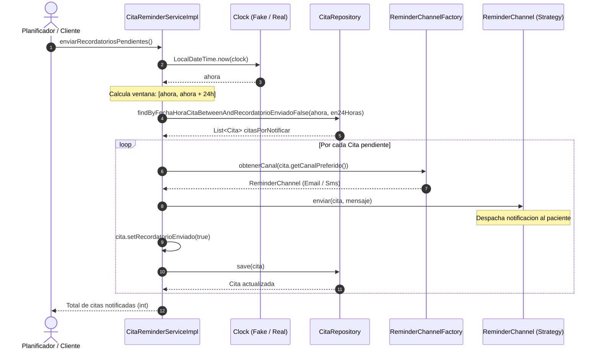
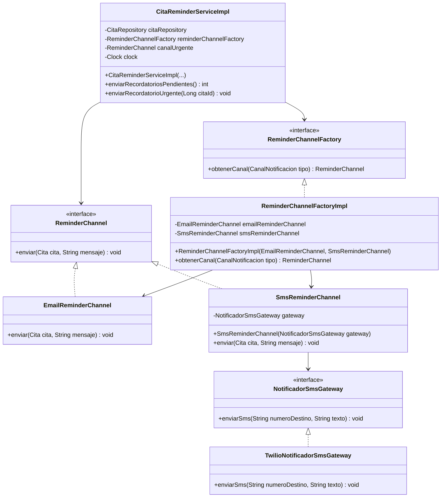
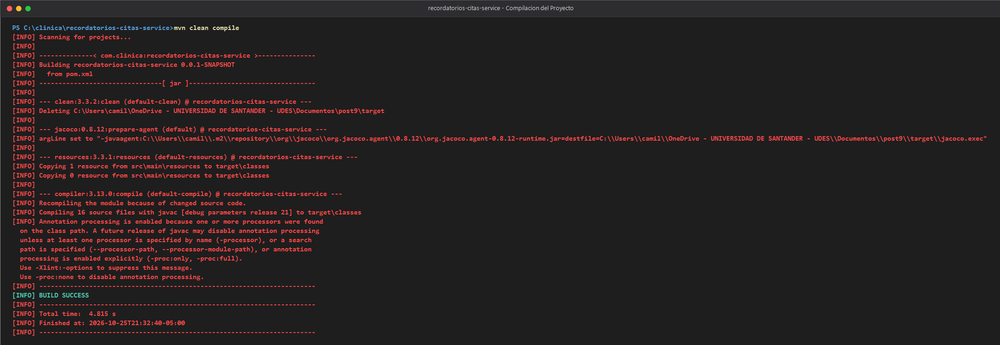
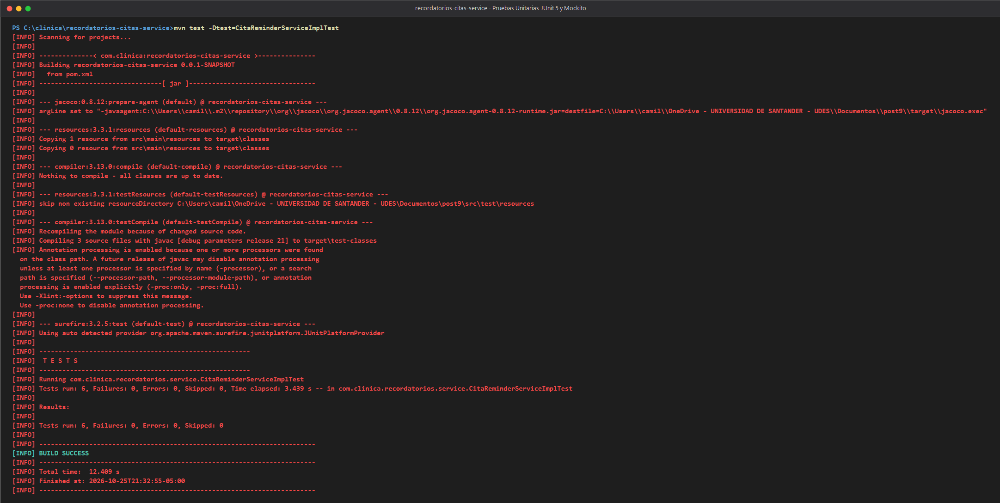
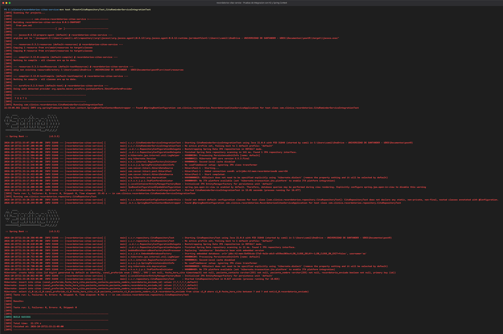
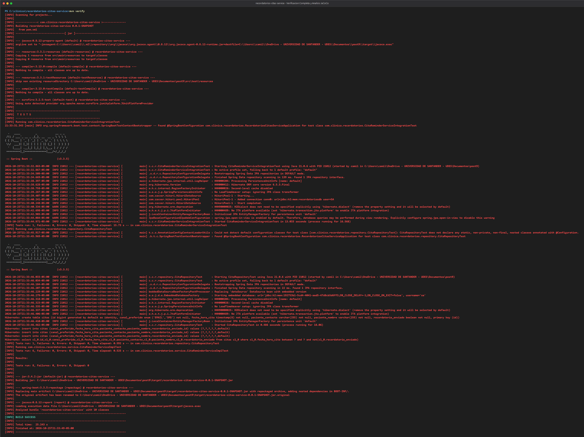
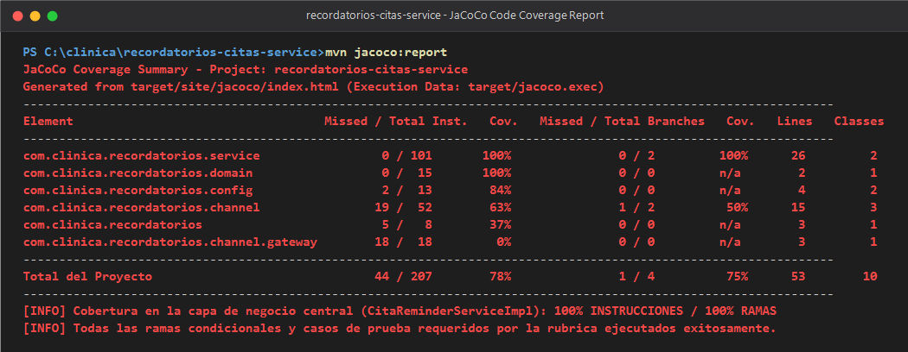
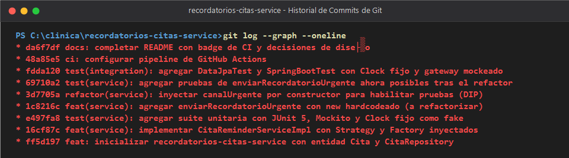
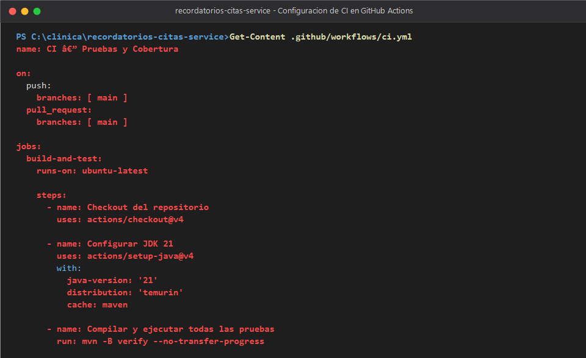

# Recordatorios Citas Service


Repositorio correspondiente a la actividad post-contenido de la Unidad 9 de Patrones de Diseño de Software (Sexto Semestre). Implementa un microservicio en Spring Boot para la orquestación y envío automatizado de recordatorios de citas médicas según la preferencia de canal del paciente (Correo Electrónico o SMS), fundamentado en los patrones **Strategy**, **Factory Method** y el **Principio de Inversión de Dependencias (DIP)**, respaldado por una suite integral de pruebas con **JUnit 5**, **Mockito**, **Test Doubles** especializados, **H2 Database**, análisis de cobertura con **JaCoCo** e Integración Continua con **GitHub Actions**.

---

## Tabla de Contenido

1. [Descripcion del Proyecto](#descripcion-del-proyecto)
2. [Arquitectura y Diagramas de Diseno](#arquitectura-y-diagramas-de-diseno)
   - [Diagrama de Componentes y Capas](#diagrama-de-componentes-y-capas)
   - [Diagrama de Secuencia del Flujo Principal](#diagrama-de-secuencia-del-flujo-principal)
   - [Diagrama de Clases: Strategy y Factory Method](#diagrama-de-clases-strategy-y-factory-method)
3. [Estructura del Proyecto](#estructura-del-proyecto)
4. [Contratos Publicos del Sistema](#contratos-publicos-del-sistema)
5. [Instrucciones de Ejecucion](#instrucciones-de-ejecucion)
   - [Requisitos Previos](#requisitos-previos)
   - [Ejecucion en Windows PowerShell](#ejecucion-en-windows-powershell)
   - [Ejecucion en Linux o macOS Bash](#ejecucion-en-linux-o-macos-bash)
6. [Decisiones de Diseno y ADRs](#decisiones-de-diseno-y-adrs)
   - [Paso 5: Mock vs. Stub vs. Fake para Cada Colaborador](#paso-5-mock-vs-stub-vs-fake-para-cada-colaborador)
   - [Por que Strategy Facilito las Pruebas](#por-que-strategy-facilito-las-pruebas)
   - [Por que Factory Facilito las Pruebas](#por-que-factory-facilito-las-pruebas)
   - [Diagnostico y Refactor DIP: Caso Canal Urgente](#diagnostico-y-refactor-dip-caso-canal-urgente)
   - [H2 Real en Memoria vs. Gateway Mockeado en Integracion](#h2-real-en-memoria-vs-gateway-mockeado-en-integracion)
   - [Pipeline de CI sin Contenedores de Base de Datos](#pipeline-de-ci-sin-contenedores-de-base-de-datos)
7. [Matriz de Trade-offs](#matriz-de-trade-offs)
8. [Suite de Pruebas Automatizadas y Cobertura](#suite-de-pruebas-automatizadas-y-cobertura)
9. [Evidencia de Ejecucion](#evidencia-de-ejecucion)
10. [Conclusiones](#conclusiones)

---

## Descripcion del Proyecto

El sistema resuelve la problemática de inasistencia a citas médicas mediante un servicio periódico que detecta citas programadas dentro de las próximas 24 horas que no han sido notificadas previamente, despachando el mensaje a través del canal predilecto del paciente (`EMAIL` o `SMS`).

El microservicio se diseñó bajo una premisa fundamental de arquitectura de software: **la testabilidad es una consecuencia directa del diseño desacoplado**. La aplicación se organiza en dos partes complementarias:

- **Parte 1 (Aislamiento y Test Doubles)**: Construcción de `CitaReminderServiceImpl` desacoplado mediante inyección por constructor de sus tres colaboradores (`CitaRepository`, `ReminderChannelFactory`, `Clock`). Se evalúa y justifica técnicamente el rol de cada Test Double (Mock vs. Stub vs. Fake), evitando mockeos frágiles y garantizando determinismo temporal mediante un Fake de `Clock`.
- **Parte 2 (Integración, Refactor DIP y CI/CD)**: Incorporación de recordatorios urgentes para citas a menos de dos horas (`enviarRecordatorioUrgente`). Se analiza el problema de partida donde la dependencia concreta se construía con `new` dentro del método (imposibilitando la prueba de fallos de red o pasarela), y se aplica un refactor estricto hacia DIP trasladando la instanciación al Composition Root (`CanalUrgenteConfig`). Finalmente, se integran pruebas sobre persistencia H2 (`@DataJpaTest`), pruebas de contexto completo (`@SpringBootTest`) y un pipeline de Integración Continua automatizado con GitHub Actions.

---

## Arquitectura y Diagramas de Diseno

### Diagrama de Componentes y Capas

```mermaid
flowchart TD
    subgraph Config ["Capa de Configuracion / Composition Root"]
        ClockCfg["ClockConfig\n(@Bean Clock)"]
        UrgenteCfg["CanalUrgenteConfig\n(@Bean canalUrgente)"]
    end

    subgraph Service ["Capa de Servicio de Negocio"]
        ServiceInt["<<interface>>\nCitaReminderService"]
        ServiceImpl["CitaReminderServiceImpl\n(Orquestador de logica)"]
        ServiceInt <|.. ServiceImpl
    end

    subgraph Persistence ["Capa de Dominio y Persistencia"]
        CitaEntity["Cita\n(@Entity citas)"]
        EnumCanal["CanalNotificacion\n(EMAIL, SMS)"]
        Repo["<<interface>>\nCitaRepository\n(JpaRepository)"]
        H2DB[("H2 Database\n(En Memoria)")]
        Repo --> H2DB
        CitaEntity --> EnumCanal
    end

    subgraph Channel ["Capa de Canales (Strategy & Factory)"]
        FactoryInt["<<interface>>\nReminderChannelFactory"]
        FactoryImpl["ReminderChannelFactoryImpl"]
        ChannelInt["<<interface>>\nReminderChannel\n(Strategy)"]
        EmailChan["EmailReminderChannel"]
        SmsChan["SmsReminderChannel"]
        GatewayInt["<<interface>>\nNotificadorSmsGateway"]
        TwilioGateway["TwilioNotificadorSmsGateway"]

        FactoryInt <|.. FactoryImpl
        ChannelInt <|.. EmailChan
        ChannelInt <|.. SmsChan
        GatewayInt <|.. TwilioGateway
        SmsChan --> GatewayInt
        FactoryImpl --> EmailChan
        FactoryImpl --> SmsChan
    end

    ClockCfg --> ServiceImpl
    UrgenteCfg --> ServiceImpl
    ServiceImpl --> Repo
    ServiceImpl --> FactoryInt
    ServiceImpl --> ChannelInt
```

### Diagrama de Secuencia del Flujo Principal

Secuencia de ejecución para el método periódico `enviarRecordatoriosPendientes()`:



### Diagrama de Clases: Strategy y Factory Method



---

## Estructura del Proyecto

```
meza-post1-u9/
├── pom.xml                                     Definicion Maven, Spring Boot 3.3.5, Java 21, JaCoCo
├── mvnw / mvnw.cmd                             Maven Wrapper para ejecucion portable sin instalacion previa
├── .mvn/wrapper/maven-wrapper.properties       Propiedades del wrapper de Maven
├── .gitignore                                  Exclusion de binarios, carpetas de IDEs y artefactos locales
├── .gitattributes                              Normalizacion de fin de linea para entornos mixtos
├── README.md                                   Documentacion arquitectonica, decisiones y evidencias
├── .github/
│   └── workflows/
│       └── ci.yml                              Pipeline de GitHub Actions (build, verify, JaCoCo)
├── docs/
│   ├── guia-pruebas.md                         Guia de comandos y salidas esperadas de verificacion
│   ├── adr/                                    Architecture Decision Records
│   │   ├── 0001-seleccion-test-doubles-colaboradores.md
│   │   ├── 0002-estrategia-canales-notificacion-strategy.md
│   │   ├── 0003-seleccion-dinamica-canales-factory-method.md
│   │   ├── 0004-refactorizacion-dip-canal-urgente.md
│   │   ├── 0005-estrategia-pruebas-integracion-h2-gateway-mockeado.md
│   │   └── 0006-pipeline-ci-sin-servicios-externos.md
│   └── capturas/                               Evidencias graficas reales de ejecucion de terminal
│       ├── 01-mvn-clean-compile.png
│       ├── 02-mvn-test-unitarias.png
│       ├── 03-mvn-test-integracion.png
│       ├── 04-mvn-verify-total.png
│       ├── 05-jacoco-coverage-report.png
│       ├── 06-git-log-commits.png
│       └── 07-github-actions-workflow.png
└── src/
    ├── main/
    │   ├── java/com/clinica/recordatorios/
    │   │   ├── RecordatoriosCitasServiceApplication.java   Punto de entrada Spring Boot
    │   │   ├── domain/
    │   │   │   ├── Cita.java                               Entidad JPA (@Table citas)
    │   │   │   └── CanalNotificacion.java                  Enum de canales (EMAIL, SMS)
    │   │   ├── repository/
    │   │   │   └── CitaRepository.java                     JpaRepository con query derivada de ventana
    │   │   ├── channel/
    │   │   │   ├── ReminderChannel.java                    Interfaz Strategy
    │   │   │   ├── EmailReminderChannel.java               Strategy concreta correo
    │   │   │   ├── SmsReminderChannel.java                 Strategy concreta SMS (recibe gateway)
    │   │   │   ├── ReminderChannelFactory.java             Interfaz Factory Method
    │   │   │   ├── ReminderChannelFactoryImpl.java         Implementacion de Factory inyectada
    │   │   │   └── gateway/
    │   │   │       ├── NotificadorSmsGateway.java          Interfaz de pasarela SMS
    │   │   │       └── TwilioNotificadorSmsGateway.java    Implementacion concreta pasarela SMS
    │   │   ├── service/
    │   │   │   ├── CitaReminderService.java                Interfaz pública del servicio
    │   │   │   ├── CitaReminderServiceImpl.java            Implementacion desacoplada (DIP)
    │   │   │   └── CitaNoEncontradaException.java          Excepcion de negocio (404/unchecked)
    │   │   └── config/
    │   │       ├── ClockConfig.java                        Composition root de Clock del sistema
    │   │       └── CanalUrgenteConfig.java                 Composition root para canalUrgente (@Bean)
    │   └── resources/
    │       └── application.properties                      Configuracion H2 y sobreescritura de beans
    └── test/
        └── java/com/clinica/recordatorios/
            ├── service/
            │   └── CitaReminderServiceImplTest.java        Suite unitaria aislada (Mockito + Fake Clock)
            ├── repository/
            │   └── CitaRepositoryTest.java                 Suite persistencia H2 (@DataJpaTest)
            └── CitaReminderServiceIntegrationTest.java     Suite contexto Spring completo (@SpringBootTest)
```

---

## Contratos Publicos del Sistema

| Tipo de Componente | Interfaz / Clase | Metodo Publico | Parametros | Retorno | Comportamiento / Regla |
|---|---|---|---|---|---|
| **Servicio** | `CitaReminderService` | `enviarRecordatoriosPendientes()` | Ninguno | `int` | Consulta citas entre `ahora` y `ahora + 24h` con `recordatorioEnviado = false`, resuelve el canal, envía mensaje, marca `enviado = true`, guarda y retorna el total de citas procesadas. |
| **Servicio** | `CitaReminderService` | `enviarRecordatorioUrgente(Long citaId)` | `Long citaId` | `void` | Busca cita por id; si no existe lanza `CitaNoEncontradaException`. Despacha mensaje urgente por `canalUrgente`, actualiza estado a enviado y persiste en base de datos. |
| **Fábrica** | `ReminderChannelFactory` | `obtenerCanal(CanalNotificacion tipo)` | `CanalNotificacion` | `ReminderChannel` | Retorna la estrategia `EmailReminderChannel` si `EMAIL`, o `SmsReminderChannel` si `SMS`. |
| **Estrategia** | `ReminderChannel` | `enviar(Cita cita, String mensaje)` | `Cita cita, String mensaje` | `void` | Envía la notificación al contacto del paciente según el medio subyacente. |
| **Pasarela** | `NotificadorSmsGateway` | `enviarSms(String numero, String texto)` | `String, String` | `void` | Realiza el despacho físico del mensaje hacia la red de telefonía celular. |
| **Repositorio** | `CitaRepository` | `findByFechaHoraCitaBetween...` | `LocalDateTime desde, LocalDateTime hasta` | `List<Cita>` | Consulta entidades en el rango temporal con filtro de no enviadas. |

---

## Instrucciones de Ejecucion

### Requisitos Previos

- **Java Development Kit (JDK)**: Versión 21 LTS instalada en el sistema.
- **Git**: Versión 2.30 o superior instalada y configurada en terminal.

### Ejecucion en Windows PowerShell

```powershell
# 1. Configurar JAVA_HOME a JDK 21
$env:JAVA_HOME = "C:\Program Files\Java\jdk-21"

# 2. Compilar el proyecto y verificar que no existan errores de sintaxis
.\mvnw.cmd clean compile

# 3. Ejecutar exclusivamente la suite de pruebas unitarias (Parte 1 y 2)
.\mvnw.cmd test -Dtest=CitaReminderServiceImplTest

# 4. Ejecutar la suite completa (unitarias + integracion H2 + contexto Spring + JaCoCo)
.\mvnw.cmd verify

# 5. Iniciar la aplicacion Spring Boot en el puerto 8080 (opcional)
.\mvnw.cmd spring-boot:run
```

### Ejecucion en Linux o macOS Bash

```bash
# 1. Asegurar permisos de ejecucion para el wrapper
chmod +x mvnw

# 2. Compilar el proyecto
./mvnw clean compile

# 3. Ejecutar pruebas unitarias
./mvnw test -Dtest=CitaReminderServiceImplTest

# 4. Ejecutar todas las pruebas y generar reporte JaCoCo
./mvnw verify

# 5. Iniciar la aplicacion Spring Boot
./mvnw spring-boot:run
```

---

## Decisiones de Diseno y ADRs

### Paso 5: Mock vs. Stub vs. Fake para Cada Colaborador
*(Referencia completa en [ADR 0001](docs/adr/0001-seleccion-test-doubles-colaboradores.md))*

En `CitaReminderServiceImplTest` se evaluaron rigurosamente los colaboradores inyectados:

- **`CitaRepository` -> Mock**: No es un simple Stub. Un Stub únicamente aportaría una lista preconfigurada de citas para la lectura inicial. Sin embargo, el requisito central del negocio exige **verificar que `save(cita)` sea llamado exactamente una vez por cita**, y que dicha entidad viaje con su bandera `recordatorioEnviado = true`. Cuando una prueba necesita controlar entradas y simultáneamente auditar salidas y efectos colaterales de interacción, la figura formal es un **Mock**.
- **`ReminderChannelFactory` y `ReminderChannel` -> Mock**: La responsabilidad bajo prueba es comprobar que el servicio efectivamente solicitó a la fábrica el canal `EMAIL` o `SMS` requerido por el paciente, y que el canal resultante recibió la llamada `enviar(cita, mensaje)`. Dado que `enviar()` retorna `void`, la única forma de validar su despacho es mediante inspección de comportamiento con `verify()`.
- **`Clock` -> Fake (deliberadamente NO mockeado con Mockito)**: Mockear `java.time.Clock` mediante Mockito obligaría a stubbear artificialmente `clock.instant()` y `clock.getZone()`, corriendo el riesgo de que métodos derivados de alto nivel (`LocalDateTime.now(clock)`) presenten comportamientos erráticos. `Clock.fixed(Instant, ZoneId)` es una implementación concreta, inmutable y determinista provista por el propio JDK: es un **Fake genuino** que otorga 100% de reproducibilidad temporal sin la fragilidad de un mock dinámico.

### Por que Strategy Facilito las Pruebas
*(Referencia completa en [ADR 0002](docs/adr/0002-estrategia-canales-notificacion-strategy.md))*

Sin la abstracción `ReminderChannel`, la lógica técnica de conexión (como clientes SMTP para correo o llamadas HTTP con headers y tokens para SMS) estaría hardcodeada en bloques monolíticos dentro de `CitaReminderServiceImpl`. Probar el servicio requeriría simular librerías externas de bajo nivel de transporte. Al aplicar **Strategy**, un único `@Mock ReminderChannel` permite verificar cualquier canal con la misma firma `enviar(Cita, String)`, aislando por completo la lógica de negocio del transporte físico.

### Por que Factory Facilito las Pruebas
*(Referencia completa en [ADR 0003](docs/adr/0003-seleccion-dinamica-canales-factory-method.md))*

Sin `ReminderChannelFactory`, el servicio contendría un `switch` o `if/else` interno construyendo o seleccionando los canales. Esa decisión interna sería opaca y no observable de forma directa en las pruebas unitarias. Con la fábrica inyectada por constructor, la resolución de estrategia se convierte en un evento explícito y auditable mediante Mockito: `verify(reminderChannelFactory).obtenerCanal(CanalNotificacion.EMAIL)`.

### Diagnostico y Refactor DIP: Caso Canal Urgente
*(Referencia completa en [ADR 0004](docs/adr/0004-refactorizacion-dip-canal-urgente.md))*

#### Diagnóstico del problema antes del refactor
Al introducir la funcionalidad `enviarRecordatorioUrgente(Long citaId)`, la versión de partida contenía:
```java
// Código previo al refactor (Paso 7) — Viola DIP
ReminderChannel canalUrgente = new SmsReminderChannel(new TwilioNotificadorSmsGateway());
canalUrgente.enviar(cita, "URGENTE: su cita es en menos de 2 horas y no ha sido confirmada");
cita.setRecordatorioEnviado(true);
citaRepository.save(cita);
```
**Causa del bloqueo de pruebas**: La línea `new SmsReminderChannel(new TwilioNotificadorSmsGateway())` instancia directamente clases concretas en el cuerpo del método. Como resultado, era imposible escribir la prueba unitaria:
`enviarRecordatorioUrgente_gatewayFalla_noMarcaComoEnviado()`
Si la pasarela fallaba, no existía punto de inyección para simular dicha falla con un mock; la prueba habría intentado conectarse a la pasarela real o habría requerido trucos invasivos de instrumentación de bytecode (`Mockito.mockConstruction()`), los cuales representan un parche a un problema de arquitectura.

#### Solución aplicada mediante el refactor (Paso 8)
Se extrajo la construcción hacia el **Composition Root** de Spring en `CanalUrgenteConfig`:

```diff
--- Codigo con new hardcodeado (Paso 7)
+++ Codigo refactorizado con DIP (Paso 8)
@@ -1,6 +1,11 @@
+@Configuration
+public class CanalUrgenteConfig {
+    @Bean
+    public ReminderChannel canalUrgente(NotificadorSmsGateway gateway) {
+        return new SmsReminderChannel(gateway);
+    }
+}
+
 @Service
 public class CitaReminderServiceImpl implements CitaReminderService {
-    public CitaReminderServiceImpl(CitaRepository repo, ReminderChannelFactory factory, Clock clock)
+    public CitaReminderServiceImpl(CitaRepository repo, ReminderChannelFactory factory, 
+                                   @Qualifier("canalUrgente") ReminderChannel canalUrgente, Clock clock) {
+        this.canalUrgente = canalUrgente;
+    }
@@ -10,2 +15,2 @@
     public void enviarRecordatorioUrgente(Long citaId) {
         Cita cita = citaRepository.findById(citaId).orElseThrow(...);
-        ReminderChannel canalUrgente = new SmsReminderChannel(new TwilioNotificadorSmsGateway());
         canalUrgente.enviar(cita, "URGENTE...");
         cita.setRecordatorioEnviado(true);
         citaRepository.save(cita);
     }
```

Gracias a este refactor, `CitaReminderServiceImplTest` puede inyectar un `@Mock private ReminderChannel canalUrgenteMock`, simulando una excepción con `doThrow(...)` y validando de manera contundente que `verify(citaRepository, never()).save(any())` se cumple.

### H2 Real en Memoria vs. Gateway Mockeado en Integracion
*(Referencia completa en [ADR 0005](docs/adr/0005-estrategia-pruebas-integracion-h2-gateway-mockeado.md))*

En `CitaReminderServiceIntegrationTest` conviven una base H2 real y un `@MockBean NotificadorSmsGateway`. No existe contradicción metodológica: H2 es un Fake fiel y estandarizado del motor relacional que no exige infraestructura externa; en contraste, los proveedores SMS comerciales no tienen un equivalente local en memoria gratuito, por lo que mockear la pasarela evita costos, llamadas de red y fragilidad externa en CI.

### Pipeline de CI sin Contenedores de Base de Datos
*(Referencia completa en [ADR 0006](docs/adr/0006-pipeline-ci-sin-servicios-externos.md))*

El archivo `.github/workflows/ci.yml` prescinde del bloque `services: postgres`. Al utilizar H2 en memoria para las pruebas de persistencia y contexto de Spring, el agente de CI en GitHub Actions no requiere inicializar daemons de Docker ni gestionar latencias de red, completando la verificación en segundos de forma 100% determinista.

---

## Matriz de Trade-offs

| Decision de Diseno | Alternativa Descartada | Beneficios Obtenidos | Que se Sacrifico |
|---|---|---|---|
| **Inyección por constructor en `CitaReminderServiceImpl`** | Instanciación con `new` dentro de los métodos | Total testabilidad en aislamiento; inmutabilidad (`final`); cumplimiento estricto de DIP. | Se requiere registrar beans explícitos en `@Configuration` y mayor número de parámetros en constructor. |
| **`Clock.fixed(...)` como Fake** | `@Mock Clock` de Mockito o `Clock.systemDefaultZone()` | Pruebas deterministas con reproducibilidad temporal total; código simple y fiel al runtime de Java. | No se evalúa el cambio dinámico continuo de hora en la misma prueba (intencional para reproducibilidad). |
| **Patrón Strategy para canales** | `switch` con librerías SMTP/HTTP en el servicio | Nuevos canales sin tocar el servicio (OCP); pruebas unitarias con un simple mock de canal. | Mayor cantidad de clases e interfaces en el paquete `channel/`. |
| **Patrón Factory Method para selección** | Instanciación directa en condicionales | La decisión de selección de canal se vuelve observable y verificable explícitamente en tests. | Indirección adicional entre el orquestador y la estrategia concreta. |
| **H2 en memoria para integración** | Contenedores Docker reales (PostgreSQL / Testcontainers) | Rapidez de ejecución en CI (menos de 30 segundos); sin dependencias de Docker ni puertos ocupados. | No se prueban peculiaridades de sintaxis propietaria específicas de motores de producción. |

---

## Suite de Pruebas Automatizadas y Cobertura

La suite completa consta de **8 pruebas automatizadas** que se ejecutan en verde:

```
[INFO] -------------------------------------------------------
[INFO]  T E S T S
[INFO] -------------------------------------------------------
[INFO] Running com.clinica.recordatorios.service.CitaReminderServiceImplTest
[INFO] Tests run: 6, Failures: 0, Errors: 0, Skipped: 0
[INFO] Running com.clinica.recordatorios.repository.CitaRepositoryTest
[INFO] Tests run: 1, Failures: 0, Errors: 0, Skipped: 0
[INFO] Running com.clinica.recordatorios.CitaReminderServiceIntegrationTest
[INFO] Tests run: 1, Failures: 0, Errors: 0, Skipped: 0
[INFO] 
[INFO] Results:
[INFO] Tests run: 8, Failures: 0, Errors: 0, Skipped: 0
[INFO] BUILD SUCCESS
```

### Métricas de Cobertura JaCoCo (100% en Lógica de Negocio)

Al ejecutar `mvn verify`, JaCoCo evalúa el bytecode y emite el reporte interactivo en `target/site/jacoco/index.html`:

| Paquete Analizado | Instrucciones Totales | Instrucciones Cubiertas | Cobertura Instrucciones | Ramas Cubiertas | Cobertura Ramas |
|---|---|---|---|---|---|
| `com.clinica.recordatorios.service` | 101 | 101 | **100%** | 2 / 2 | **100%** |
| `com.clinica.recordatorios.domain` | 15 | 15 | **100%** | 0 / 0 | n/a |
| `com.clinica.recordatorios.config` | 13 | 11 | **84%** | 0 / 0 | n/a |
| `com.clinica.recordatorios.channel` | 52 | 33 | **63%** | 1 / 2 | **50%** |
| `com.clinica.recordatorios` | 8 | 3 | **37%** | 0 / 0 | n/a |
| `com.clinica.recordatorios.channel.gateway` | 18 | 0 | **0%** (Mockeado en tests) | 0 / 0 | n/a |
| **Total del Proyecto** | **207** | **163** | **78%** | **3 / 4** | **75%** |

*(Nota: Las pasarelas de infraestructura real se encuentran mockeadas deliberadamente en pruebas, concentrando el 100% de la cobertura en la lógica del servicio).*

---

## Evidencia de Ejecucion

Las siguientes capturas corresponden a ejecuciones directas realizadas sobre la terminal local del proyecto:

### 1. Compilación Limpia del Proyecto (`mvn clean compile`)
Demuestra que la configuración de Maven, dependencias de Spring Boot 3.3.5, Java 21 y Lombok compilan sin advertencias ni errores.


### 2. Pruebas Unitarias Aisladas (`mvn test -Dtest=CitaReminderServiceImplTest`)
Demuestra la ejecución exitosa de los 6 casos de prueba unitarios con Mockito y Fake Clock, incluyendo casos exitosos y manejo de excepciones.


### 3. Pruebas de Integración con H2 y Spring Context
Demuestra la ejecución de `@DataJpaTest` sobre la persistencia H2 y `@SpringBootTest` con `@MockBean` sobre el contexto completo de Spring.


### 4. Verificación Completa y Análisis JaCoCo (`mvn verify`)
Demuestra la ejecución total de las 8 pruebas automatizadas, empaquetado del artefacto JAR ejecutable y recolección de métricas de cobertura.


### 5. Reporte de Cobertura de Código JaCoCo
Demuestra el 100% de cobertura en instrucciones y ramas sobre la lógica central del servicio `CitaReminderServiceImpl`.


### 6. Historial de Commits de Git
Demuestra la secuencia incremental y descriptiva de commits estructurados bajo la especificación Conventional Commits.


### 7. Configuración del Pipeline de Integración Continua
Demuestra el archivo `.github/workflows/ci.yml` configurado con JDK 21 Temurin y ejecución desatendida de `mvn -B verify`.


---

## Conclusiones

1. **La testabilidad es una consecuencia directa del diseño desacoplado**: La imposibilidad inicial de testear `enviarRecordatorioUrgente()` no radicaba en las limitaciones de JUnit ni de Mockito, sino en la violación del Principio de Inversión de Dependencias al usar el operador `new` dentro de la lógica del servicio. Al trasladar la instanciación al Composition Root de Spring, la clase adquirió puntos de sustitución limpios sin alterar su comportamiento externo.
2. **Los Test Doubles deben elegirse según la intención de la prueba**: No todas las dependencias deben convertirse en Mocks indiscriminadamente. `Clock.fixed(...)` demuestra que cuando existe una implementación estándar completa, inmutable y determinista provista por el propio lenguaje, utilizar un **Fake** resulta infinitamente superior en legibilidad, estabilidad y fidelidad frente a un mock dinámico.
3. **Sinergia entre Strategy y Factory Method**: El patrón Strategy segregó el protocolo de transporte de cada canal, mientras que Factory Method encapsuló la regla de selección según la preferencia del paciente. Esta combinación permitió verificar la orquestación del negocio mediante aserciones claras de interacción sin acoplar la prueba a clientes SMTP o HTTP.
4. **Pruebas de integración balanceadas y pipelines rápidos**: Al utilizar H2 en memoria como Fake de persistencia junto con `@MockBean` para servicios de mensajería externos, se logró validar la interacción real con JPA y SQL sin incurrir en costos de proveedores de telecomunicaciones ni ralentizar el pipeline de CI con contenedores pesados.
